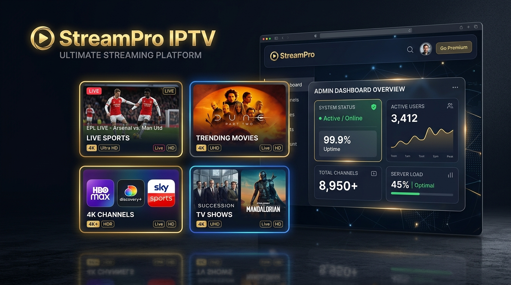

<div align="center">

  # 📺 StreamPro IPTV
  ### Premium Streaming Platform & Interactive Admin CMS Dashboard

  <p align="center">
    A production-ready, high-converting IPTV subscription landing page paired with a client-side Admin Content Management System (CMS), multi-language internationalization (AR / FR / EN), and real-time content synchronization.
  </p>

  <p align="center">
    
    
    
    
    
  </p>

  <p align="center">
    <a href="#-features">Features</a> •
    <a href="#-admin-dashboard">Admin Dashboard</a> •
    <a href="#-project-architecture">Architecture</a> •
    <a href="#-quick-start">Quick Start</a> •
    <a href="#-github-pages-deployment">Deployment</a> •
    <a href="#-arabic-summary">عن المشروع</a>
  </p>

  <br />

  

</div>

---

## 🌟 Overview

**StreamPro IPTV** is a full-featured web solution designed for digital media streaming providers. It bridges a sleek, high-conversion customer storefront with an intuitive management back-office, requiring **zero backend infrastructure** while providing seamless persistence and dynamic updates.

### ✨ Highlights
- **Dual Architecture**: Public landing page (`index.html`) + Private administrative CMS (`admin.html`).
- **Zero Server Setup**: Fully client-side architecture leveraging `localStorage` for dynamic state and `EmailJS` for serverless communication.
- **RTL & LTR Native**: Built with first-class Arabic support (Right-To-Left) alongside fluent French and English adaptations (Left-To-Right).
- **Modern Streaming Aesthetic**: Dark mode interface inspired by premier streaming platforms, featuring gold and electric blue accents, glassmorphic surfaces, and micro-interactions.

---

## 🚀 Features

### 🖥️ Customer Landing Page (`index.html`)
- **Hero Showcase**: Glowing typography, animated statistics counters, and lightweight interactive floating canvas particles.
- **Channels Ticker**: Infinite CSS marquee showcasing premium global sports, cinema, news, and kids channels.
- **Dynamic Pricing Table**: Interactive plan cards with highlight badges ("Most Popular", "Save %"), device limits, and instant subscription triggers.
- **Trilingual Internationalization (i18n)**: One-click switcher for **Arabic (العربية)**, **French (Français)**, and **English**, automatically switching document direction (`dir="rtl"` / `dir="ltr"`) and typography (`Cairo` vs `Poppins`).
- **Interactive FAQ Accordion**: Expandable Q&A accordion designed for maximum conversion and friction elimination.
- **Customer Testimonials**: Social proof section featuring user feedback, ratings, and regional tags.
- **Serverless Contact Form**: Direct customer inquiry submission with real-time feedback and EmailJS integration.

### 🛠️ Administrative CMS Dashboard (`admin.html`)
- **Authentication Gateway**: Built-in login screen with credential validation and session handling.
- **Pricing Manager**: Adjust plan names, monthly/yearly rates, discount tags, device limits, and toggle "Popular" badges on the fly.
- **Testimonial Management**: Add, edit, or remove customer reviews and 5-star ratings.
- **FAQ Manager**: Update question-answer pairs to address evolving customer inquiries.
- **Site Configuration**: Update contact email address, branding name, admin credentials, and EmailJS API keys.
- **Real-Time Site Sync**: Changes saved in the dashboard reflect instantly on the public website via unified LocalStorage events.

---

## 📐 Project Architecture

```
streampro-iptv/
├── assets/
│   └── preview.jpg          # High-resolution portfolio showcase banner
├── css/
│   ├── admin.css            # Dashboard styling, sidebar layout, forms, toasts
│   └── style.css            # Landing page styling, responsive grid, animations
├── js/
│   ├── admin.js             # CMS logic, authentication, CRUD operations & sync
│   └── main.js              # Landing page interactivity, i18n dictionary, animations
├── admin.html               # Back-office administration panel
├── index.html               # Public storefront & landing page
├── .gitignore               # Ignored system & temporary files
├── LICENSE                  # MIT Open Source License
└── README.md                # Comprehensive documentation
```

---

## 🛠️ Technologies Used

| Technology | Purpose |
| :--- | :--- |
| **HTML5 (Semantic)** | Accessible, SEO-friendly layout structure with Open Graph metadata |
| **CSS3 (Modern Vanilla)** | Custom properties, CSS Grid, Flexbox, glassmorphism, keyframe animations |
| **JavaScript (ES6+)** | Dynamic DOM manipulation, IntersectionObserver, Async/Await, i18n engine |
| **LocalStorage API** | Client-side persistent data layer syncing landing page with admin CMS |
| **EmailJS SDK** | Serverless email delivery directly from the contact form |
| **Google Fonts** | `Cairo` for Arabic typography and `Poppins` for Latin scripts |

---

## 🚦 Quick Start

### 1. Clone or Download the Repository
```bash
git clone https://github.com/biga5645/streampro-iptv.git
cd streampro-iptv
```

### 2. Run Locally
Because this project uses vanilla web standards, you do not need to install `npm` dependencies.

You can run it in any of the following ways:
- **Direct**: Double click [`index.html`](index.html) to open in your default browser.
- **VS Code Live Server**: Right click `index.html` → *Open with Live Server*.
- **Python**:
  ```bash
  python -m http.server 3000
  ```
  Open `http://localhost:3000` in your browser.
- **Node (npx serve)**:
  ```bash
  npx serve .
  ```

### 3. Access Admin Panel
- Navigate to [`admin.html`](admin.html) or click the internal dashboard links.
- **Demo Credentials**:
  - **Username**: `admin`
  - **Password**: `admin123`

---

## 🌐 GitHub Pages Deployment

Deploy your live showcase in seconds using GitHub Pages:

1. Push this repository to your GitHub account:
   ```bash
   git init
   git add .
   git commit -m "feat: initial commit - StreamPro IPTV portfolio project"
   git branch -M main
   git remote add origin https://github.com/biga5645/streampro-iptv.git
   git push -u origin main
   ```
2. In your GitHub repository, go to **Settings** → **Pages**.
3. Under **Branch**, select `main` and root `/ (root)`.
4. Click **Save**. Your live portfolio project will be published at:
   `https://biga5645.github.io/streampro-iptv/`

---

## 🇸🇦 عن المشروع (Arabic Summary)

مشروع **StreamPro IPTV** هو موقع متكامل مصمم لعرض خدمات البث التلفزيوني والاشتراكات الرقمية باحترافية عالية، يجمع بين واجهة مستخدم تسويقية جذابة ولوحة تحكم متطورة لإدارة المحتوى:

- **واجهة مستخدم عصرية**: تصميم داكن أنيق (Dark Mode) بألوان ذهبية وزرقاء متناسقة مع مؤثرات حركية خفيفة وتجاوب تام مع كافة الشاشات (Mobile, Tablet, Desktop).
- **دعم ثلاث لغات (عربي / فرنسي / إنجليزي)**: تبديل سلس وفوري بين اللغات مع ضبط اتجاه الصفحة (RTL/LTR) والخطوط المناسبة تلقائياً.
- **لوحة تحكم تفاعلية (CMS)**: إمكانية تعديل خطط الأسعار، آراء العملاء، والأسئلة الشائعة، مع حفظ التغييرات وتطبيقها مباشرة في الواجهة الرئيسية عبر `localStorage`.
- **نظام تواصل متكامل**: نموذج اشتراك واستفسار يدعم الإرسال المباشر للبريد الإلكتروني عبر خدمة `EmailJS`.
- **كود نظيف ومنظم**: كود مكتوب بتقنيات الويب القياسية (Pure HTML, CSS, JavaScript) بدون أي مكتبات ثقيلة لضمان السرعة الفائقة والأداء العالي.

---

## 📄 License

This project is licensed under the [MIT License](LICENSE) — feel free to use, modify, and build upon it for personal and commercial portfolio showcases.

---

<div align="center">
  <sub>Built with ❤️ for Modern Web Portfolio Showcase • Crafted by Developer</sub>
</div>
